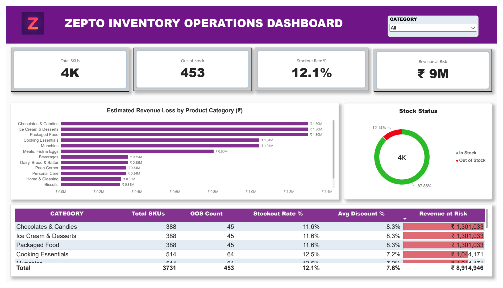
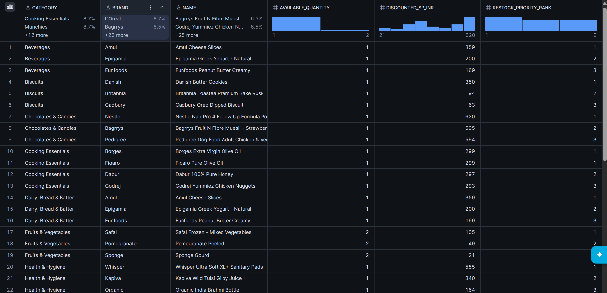

# Zepto End-to-End Inventory Pipeline

**Tech Stack:** Python (`boto3`) • AWS S3 • Snowflake • SQL • Power BI (DAX)



## 1. Why I Built This & Questions Answered
In 10-minute quick-commerce, dark stores run on tight shelf space. When an everyday item goes out of stock, Zepto doesn't just lose that single item—customers often abandon their entire cart. 

Most inventory reports only count how many products are unavailable. I built this end-to-end pipeline to answer four practical operational questions:
1. **How much revenue is actually at risk** from out-of-stock (OOS) items, and which categories are bleeding the most money?
2. **Is the stockout problem driven by high-margin impulse items or everyday staples?**
3. **Which low-stock SKUs (2 or fewer units left) need immediate restocking** before they hit zero?
4. **How can we automate the workflow** from raw CSV files to AWS S3, Snowflake, and Power BI without burning cloud credits?

---

## 2. Pipeline Architecture & Workflow

### Snowflake SQL Query Output (Restock Priority Window Function)


```text
Local CSV Catalog (3,731 SKUs)
│
├──► 1. Python Ingestion (boto3 + dotenv)
▼
AWS S3 Landing Zone (Region: ap-southeast-2 | Scoped IAM Access)
│
├──► 2. Snowflake External Stage + COPY INTO
▼
Snowflake Data Warehouse (ZEPTO_DB.ANALYTICS | 60s Auto-Suspend)
│
├──► 3. SQL Transformation View & Window Functions
▼
Power BI Operations Dashboard (DAX Measures & Category Risk Table)
```

---

## 3. What This Project Solved

### Technical Problems Solved
* **Automated Cloud Staging:** Replaced manual file uploads with a Python `boto3` script that validates local catalog files and pushes them to an AWS S3 bucket using environment variables (`.env`) so IAM keys are never exposed in code.
* **Clean CSV Parsing & Safe Math:** Configured Snowflake's file format to handle commas inside product names (`FIELD_OPTIONALLY_ENCLOSED_BY = '"'`) and used `DIV0()` when calculating price-per-100g so zero-weight items never crash the pipeline.
* **Zero Idle Cloud Billing:** Configured the Snowflake warehouse (`ZEPTO_WH`) on `X-SMALL` with a 60-second `AUTO_SUSPEND` so compute shuts down immediately after queries finish.
* **Upstream SQL Modeling:** Pushed brand extraction, discount bucketing, restock priority ranking (`DENSE_RANK() OVER (PARTITION BY category...)`), and stockout loss math into Snowflake (`VW_ZEPTO_ANALYTICS_DASHBOARD`) so Power BI stays fast and lightweight.

### Business Problems Solved (Key Findings)
Across the **3,731 unique SKUs** tracked in the dark-store catalog:
* **Stockout Rate:** **453 SKUs (12.14%)** are out of stock, while **87.86%** remain available for order.
* **Total Revenue at Risk:** Unmet demand across out-of-stock items puts **₹89,14,946 (~₹89.15 Lakhs)** at risk.
* **Catalog Discounting:** Products carry an average discount of **7.6%** off MRP.

| Product Category | Total SKUs | OOS Count | Stockout Rate % | Avg Discount % | Revenue at Risk (₹) |
| :--- | :---: | :---: | :---: | :---: | :---: |
| **Chocolates & Candies** | 388 | 45 | 11.6% | 8.3% | ₹13,01,033 |
| **Ice Cream & Desserts** | 388 | 45 | 11.6% | 8.3% | ₹13,01,033 |
| **Packaged Food** | 388 | 45 | 11.6% | 8.3% | ₹13,01,033 |
| **Cooking Essentials** | 514 | 64 | 12.5% | 7.2% | ₹10,44,171 |
| **Munchies** | 514 | 64 | 12.5% | 7.2% | ₹10,44,171 |

**Where Operations Should Act First:**
1. **Protect High-Margin Impulse Categories:** *Chocolates & Candies*, *Ice Cream & Desserts*, and *Packaged Food* represent **₹39.03 Lakhs (43.8%)** of total revenue at risk. Tightening restock buffers on these three categories recovers nearly half the total exposure.
2. **Fix Staple Stockouts to Prevent Cart Abandonment:** *Cooking Essentials* and *Munchies* have the highest stockout rate at **12.5% (64 OOS SKUs each)**, risking **₹20.88 Lakhs** combined.
3. **Pre-Emptive Restocking:** Using the SQL restock priority query (`available_quantity <= 2`), store managers can reorder high-value SKUs before they flip to out-of-stock.

---

## 4. Repository Structure

```text
zepto-end-to-end-inventory-pipeline/
├── dashboard/
│   └── Zepto_Operations_Dashboard.png      # Final Power BI dashboard view
├── data_sample/
│   └── zepto_inventory_sample.csv          # Lightweight 100-row sample dataset
├── dax/
│   └── inventory_kpi_measures.dax          # DAX formulas used for KPIs & visuals
├── scripts/
│   └── upload_to_s3.py                     # Python Boto3 script for AWS S3 staging
├── sql/
│   ├── 01_infrastructure_and_stage.sql     # Warehouse, DB, Schema & S3 Stage setup
│   ├── 02_fact_table_ingestion.sql         # Fact table DDL & COPY INTO load
│   ├── 03_analytical_view.sql              # Reporting view for Power BI
│   └── 04_advanced_business_analytics.sql  # Window functions, unit economics & brand share
├── requirements.txt                        # Python dependencies
└── README.md
```

---

## 5. How to Run This Pipeline

1. **Install dependencies:**
   ```bash
   pip install -r requirements.txt
   ```
2. **Add AWS credentials to a local `.env` file:**
   ```ini
   AWS_ACCESS_KEY_ID=your_access_key
   AWS_SECRET_ACCESS_KEY=your_secret_key
   AWS_REGION=ap-southeast-2
   S3_BUCKET_NAME=your_bucket_name
   ```
3. **Upload catalog data to AWS S3:**
   ```bash
   python scripts/upload_to_s3.py
   ```
4. **Build the Snowflake warehouse & views:**
   Run the scripts inside the `sql/` folder in order (`01` through `04`) inside a Snowflake worksheet.
5. **View the Dashboard:**
   Connect Power BI Desktop to `ZEPTO_DB.ANALYTICS.VW_ZEPTO_ANALYTICS_DASHBOARD` and apply the measures in `dax/inventory_kpi_measures.dax`.
